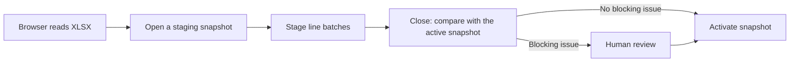

# Merchant statistics

Merchant statistics imports complete Culqi report snapshots and shows GPV by
merchant RUC, realized month, and CRM executive. Users see the term GPV. The
code is the `merchant-stats` capability, which owns imports, validation,
attribution, targets, and read models.

`m0` is the GPV realized during the sale month, `m1` the next calendar month,
and so on. A target belongs to a RUC and is effective-dated. It is the monthly
GPV the RUC should approach, not a total across an executive's portfolio.

## Snapshot lifecycle

The browser reads the report and calls the three steps in
[`imports.ts`](../apps/web/src/rpc/merchant-stats/imports.ts). The server stores
no file.

1. `openGpvImport` takes the file's SHA-256 and its cut. It returns the existing
   snapshot for a file already imported, and refuses a cut older than the active
   one. Opening drops any snapshot still staging, so an import the browser
   abandoned never blocks the next one.
2. `stageGpvImport` decodes one batch of `GPV_IMPORT_BATCH_LINES` lines and
   stores its placements and observations. A line that does not decode, a
   placement already staged, and a placement whose RUC or sale month differs
   from the active snapshot each become a blocking issue.
3. `closeGpvImport` records each active placement the snapshot lacks, then
   activates the snapshot when no issue blocks it.

Decoding is in [`intake/`](../apps/web/src/server/merchant-stats/intake/).
Staging, closing and activation are in
[`snapshot/`](../apps/web/src/server/merchant-stats/snapshot/).

A snapshot is a complete cut of the report. An import never rewrites an earlier
cut. It records blocking differences, such as a missing placement, a changed
RUC, or a changed sale month, and a person resolves them before activation.
Data-quality gaps (no owner, no target, no desk, a serial mismatch) are quality
queues, not snapshot issues, and do not block activation. Activation creates a
CRM organization, without an owner, for each RUC in the snapshot that CRM does
not have yet.

One snapshot is active. Activation locks the dataset row, supersedes the
previous active snapshot, and freezes uncredited merchant months against the
snapshot that first made them available. Activating a snapshot whose cut is
older than the active one rejects it. Equal cuts compare by revision.

## Ownership, attribution, and targets

CRM ownership decides which executive a RUC belongs to. Culqi's seller code is
report context, not the internal executive identity. An executive reads a RUC
only while they are its current CRM owner.

A snapshot freezes monthly merchant credit when it first exposes the month, so a
later ownership change does not rewrite historical progress.
[`adjustMonthCredit`](../apps/web/src/rpc/merchant-stats/attribution.ts) records
an explicit monthly credit correction.

Targets are effective-dated per RUC. Updating the same RUC and effective month
replaces that target. Adding a later effective month keeps the earlier periods.

## Commission and export

Commission rules are versioned by effective date in
`commission_scheme_versions`.
[`setCommissionScheme`](../apps/web/src/rpc/merchant-stats/commission-scheme.ts)
sets a new version. The evaluators in
[`commission/`](../apps/web/src/server/merchant-stats/commission/) apply the
rules per desk (`MESA 1` to `MESA 3`).

[`exportMerchantGpv`](../apps/web/src/server/merchant-stats/export/export-gpv.ts)
returns the filtered rows as a sheet named for the active snapshot's cut date
(`GPV AL dd-mm-yyyy.xlsx`). The browser writes the file
([Architecture](architecture.md#web-application)).

## Access

| Permission            | Access                                                         |
| --------------------- | -------------------------------------------------------------- |
| `dashboards:read`     | Team dashboards and the GPV quality summary.                   |
| `dashboards:read:own` | The caller's currently owned RUCs and progress.                |
| `dashboards:manage`   | Imports, issue resolution, targets, credits, and quality rows. |
| `commission:read`     | The commission manager dashboard.                              |
| `commission:manage`   | Reading and setting a commission scheme version.               |

## Schema and demo data

The tables are defined in
[`merchant-stats.ts`](../apps/web/src/server/platform/database/schema/modules/merchant-stats.ts)
and its types file. They include `gpv_snapshots`, `gpv_snapshot_placements`,
`gpv_snapshot_observations`, `gpv_snapshot_issues`, `merchant_month_credits`,
`merchant_month_credit_adjustments`, `commission_scheme_versions`, and
`merchant_gpv_targets`.

Demo data is in
[`seeds/demo/merchant-stats/`](../apps/web/src/server/platform/database/seeds/demo/merchant-stats/).
Schema changes follow [Database development](database.md).
